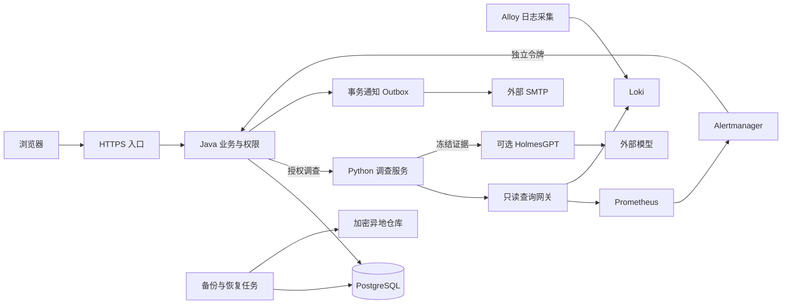

# Causelume · 故障诊断与协作平台

值班人员从告警或人工报障创建工单，分派负责人，结合指标和日志调查，再记录处理、恢复验证与复盘。提供本地演示和面向个人及企业内部小团队的单实例生产候选；公网上线仍需完成真实资源接入验收。

[文档导航](docs/README.md) · [生产接入](docs/production-setup.md) · [发布镜像与摘要](https://github.com/W205614/Causelume/actions/workflows/release.yml) · [上线边界](docs/operations.md)

- **体验界面**　打开部署后的 `/?demo=1`。页面标记「模拟数据」，可以试派工和调查；刷新会重置样例。
- **验证完整流程**　使用默认的离线模式。示例 checkout 会真正返回 503、生成日志与指标，Python 使用规则分析，全程无需模型密钥。
- **接入模型**　HolmesGPT 的两个只读工具复查该次调查冻结的证据。模型给出推断和不确定性，由负责人核对。真实调用会产生供应商费用。

## 适用范围与主要能力

首发范围是单实例、单 worker、个人及企业内部小团队的共享运维工作区。可以继续接入实际项目并完善业务；管理员管理账户、服务和派工；运维成员共享读取工单及诊断证据，负责人和管理员推进处理及导出。不同团队之间的保密隔离不属于当前共享工作区能力。当前没有完成实际企业生产环境验收，也没有多实例任务协调、租户隔离或企业统一身份集成。是否需要这些能力由实际使用范围决定，不能以功能演示或 CI 通过推定企业上线要求已经全部满足。[上线门槛与扩展条件](docs/operations.md)

| 能力 | 已实现内容 |
|---|---|
| 账户与权限 | 会话、角色、密码管理、停用与会话撤销；生产 profile 强制 TOTP 和单次恢复码 |
| 告警与通知 | Alertmanager 发生/恢复、去重、服务和环境映射、维护静默、站内消息及邮件投递状态 |
| 服务与工单 | 服务维护、负责人、筛选分页、优先级、时间线、重开、恢复依据、结构化复盘及改进项 |
| 调查与证据 | 受限 Prometheus/Loki 查询、冻结快照、来源和完整性、模型推断与人工反馈分区 |
| 费用控制 | 人工发起模型调查、每日预算预留、未知费用保留额度及人工核对 |
| 数据与交付 | H2→PostgreSQL 核对迁移、生产编排、加密备份、隔离恢复、平台指标、CI 扫描及摘要发布 |

## 控制台实景

以下均为显式演示模式（`/?demo=1`）下的真实浏览器截图，使用内置样例，不含实际账户凭据或生产日志。

查看工单时间线、调查证据和手机布局

[查看 390 像素宽的调查详情](docs/images/investigation-mobile.png)

## 本地体验与个人生产候选

本地 Docker Desktop 体验沿用 H2 和 checkout 示例。首次运行、且工作区尚无 `.env` 时执行：

~~~sh
python scripts/init_env.py
docker compose up -d --build --wait
~~~

打开 [控制台](http://127.0.0.1:18760)，从本机 .env 读取 admin 或 operator 初始密码。已有 .env 会保留，已有 H2 数据留在项目业务卷。升级前先备份并按 [迁移说明](backend/STORAGE.md) 核对新数据库，生产迁移不会自动覆盖本地库。

已有部署跳过 `init_env.py`，它通过拒绝覆盖保护现有配置。不要直接用新容器对原业务卷试跑迁移；先完成备份与副本升级验证。更新镜像需要重新创建容器，`docker restart` 不会切换到新镜像。已有数据的检查顺序见 [运维边界](docs/operations.md)。

本机专用覆盖配置可放在不入库的 `compose.override.yaml`。不指定 `-f` 时 Compose 会自动合并它；显式指定配置文件时，需要同时列出该覆盖文件。检查实际 `AGENT_MODE` 后再发起调查，避免沿用已有 `.env` 中的真实模型模式。本机维护后的具体模式和容器状态见 [小团队交付记录](docs/team-release-2026-11-06.md)。

本轮还提供 Linux 单机生产候选，使用 PostgreSQL 18、强制 TOTP、邮件与站内通知、Prometheus/Alertmanager/Loki/Alloy、人工预算调查、Caddy HTTPS 和加密备份。外部资源尚未配置时，候选代码仍可在隔离环境完成验收。实测及尚未运行项见 [个人版验收](docs/personal-release.md)。

## 后续接入云主机、域名和外部服务

准备好资源后，按照下表填写配置及执行命令即可接入。真实秘密存放在受限文件中。

| 资源 | 填写位置 | 接入与验收 |
|---|---|---|
| Linux 云主机 | 部署目录 /opt/causelume，Docker Engine/Compose，防火墙 | 拉取已验证提交、下载发布镜像，检查磁盘与资源；备份旧部署后运行发布脚本。只对外发布 80/443。 |
| 域名与 TLS | production.env 的 APP_DOMAIN、ACME_EMAIL | 将 DNS 指向主机，放通 80/443，Caddy 自动申请并续期证书；访问真实域名验证 Cookie、MFA、证书与重定向。 |
| SMTP | production.env 的 SMTP_HOST/PORT/USERNAME/FROM，secrets/SMTP_PASSWORD | 使用服务商授权凭据。登录账户安全页设置收件邮箱；发出测试通知，核对实际收件和投递状态。 |
| 异地备份 | production.env 的 RESTIC_REPOSITORY，secrets/RESTIC_PASSWORD、AWS_ACCESS_KEY_ID、AWS_SECRET_ACCESS_KEY | 初始化专用 restic 仓库，执行首次备份、隔离恢复；再启用每12小时备份与每月恢复演练定时器。 |
| 外部探测 | heartbeat.env、production.env 的 BACKUP_HEARTBEAT_URL | 在机外心跳服务创建独立的运行与备份检查。配置周期/宽限，停止心跳验证告警。勿把探测服务部署在同一台主机。 |
| 真实模型 | secrets/OPENAI_API_KEY、AGENT_MODE=holmes、COMPOSE_PROFILES=holmes、预算变量 | 先轮换曾在聊天出现的旧密钥，填写预算预留和每日额度。真实调查需人工发起；供应商账单未知时额度保持冻结。 |
| 实际应用 | 服务目录和 deployment/observability 配置 | 注册 Prom 抓取目标和 Alloy 日志标签；在页面绑定批准的 prom-loki 数据源、serviceLabel 与 environment，检测连接后演练一次真实故障。 |

首次准备服务器配置：

~~~sh
cp production.env.example production.env
python scripts/init_production.py
~~~

编辑 production.env 和 secrets/ 外部凭据文件。保管 APP_MFA_KEY 与 restic 恢复密码的独立恢复副本。生产账户的首次绑定及恢复见 [账户与数据迁移](backend/STORAGE.md)。

发布工作流支持手动触发或 v* 标签。下载 release-manifest，将已验证的 app/agent 镜像摘要填入 APP_IMAGE、AGENT_IMAGE，APP_RELEASE 填提交号。发布前查看安全扫描结果，运行：

~~~sh
docker compose --env-file production.env -f compose.production.yaml -f compose.observability.yaml config --quiet
sudo sh scripts/release.sh
~~~

发布脚本默认在 /opt/causelume 运行。已有实例更新时先执行加密备份，再迁移和检查健康。首次部署需要先初始化 restic 仓库，后续启用备份定时器。外部资源的详细接入、恢复及回退操作见 [生产接入手册](docs/production-setup.md)。

## 日常故障处理

1. Alertmanager 的发生事件按集成、fingerprint、startsAt 去重，自动创建并分派工单。恢复事件记录监控恢复，由负责人确认工单关闭。
2. 通知中心显示站内消息和邮件状态；管理员可检查失败及结果未知的投递。维护静默会继续记录告警。
3. 工单负责人发起只读调查，查看查询时间范围、来源、采集时间、截断和证据完整性。模型不持有生产修复权限。
4. 写入通过、失败或未知的恢复依据；完成结构化复盘、改进事项、授权导出。必要时可重新打开工单。

服务支持编辑、停用、环境、负责人、运行手册和批准数据源绑定。账户支持密码管理、TOTP、单次恢复码和会话撤销。费用核对、清理预览、MFA 和账户管理只向相应权限开放。历史数据清理仅提供预览。

## 架构与运行边界

Java 21/Spring Boot/Spring JDBC 负责业务、权限、持久化与任务；Python 与 HolmesGPT 负责采集和分析。生产采用 PostgreSQL，数据库迁移由启动前的独立任务执行，长期运行的业务进程不挂载迁移凭据。查询网关只放行 Prometheus/Loki 的 GET 查询入口，观测采集接口处于内部网络。通知 Outbox 与 worker 均在同一 Java 进程内，没有引入消息队列。

下图表示生产候选的已实现连接关系，外部资源是否已接入以具体部署的验收记录为准：

每次调查冻结服务范围及时间窗口。来源缺失、无样本或模型失败会显式报告。真实模型默认关闭；开启后需每日额度和单次预留，费用未知需管理员核对，预算预留不等同于供应商硬账单上限。

生产候选面向单实例、个人及企业内部小团队。RPO 24小时和 RTO 2小时是待真实异地恢复演练确认的目标。容量需按首批项目负载实测。升级数据库后回退需采用兼容应用版本或完整恢复集。

## 开发与复验

~~~sh
python -m pip install -r agent/requirements.txt
npm --prefix frontend ci
cd frontend
npx playwright install chromium
npm test
cd ..
mvn -f backend/pom.xml verify
python -m unittest discover -s agent -p "test*.py"
python scripts/verify_local.py
python scripts/verify_postgres.py
python scripts/verify_backup.py
python agent/verify_observability.py
python agent/verify_alertmanager.py
python scripts/verify_candidate.py
~~~

可用 CAUSELUME_BROWSER 指定本机 Edge/Chromium，Windows 的 Maven 路径可通过 --maven 指定。候选脚本会创建有独立名称的临时测试环境，使用合成数据、Mailpit 和离线调查。生产密钥及本地业务卷不参与自动测试。

本轮面向小团队的权限、会话、并发复核、证据归属及备份升级加固见 [小团队交付记录](docs/team-release-2026-11-06.md)。

## 常见问题

- **已有 `.env`，初始化报 FileExistsError？** 跳过初始化，保留原配置；脚本不会覆盖已有凭据。
- **CI 通过是否说明当前容器已更新？** CI 验证提交及测试环境。运行容器仍需核对实际镜像、代码和挂载配置；健康检查只表示当前进程可用。
- **没有云主机、域名或 SMTP 能运行吗？** 可以运行本地离线演示与隔离验收。生产资源的接入步骤已提供，实际送达、公开 TLS 和异地恢复仍需配置后实测。
- **能否直接启动两个业务实例提高可用性？** 当前不支持。任务重启恢复、配额和 worker 以单实例为边界，扩容需要先落实认领、租约和恢复归属。
- **哪里查看安全与版本问题？** 先查 [安全边界](backend/SECURITY.md)、[上线条件](docs/operations.md) 与对应提交的 CI/发布报告。反馈时提供提交或镜像摘要、复现步骤和脱敏错误；不要公开凭据或敏感证据。

完整文档按使用角色整理在 [文档导航](docs/README.md)。README 组织参考 [蓝鲸监控](https://github.com/TencentBlueKing/bk-monitor)、[SREWorks](https://github.com/alibaba/SREWorks)、[Nightingale](https://github.com/ccfos/nightingale) 和 [Alertmanager](https://github.com/prometheus/alertmanager) 的官方项目入口；仅借鉴文档结构，不代表能力或部署规模相同。
