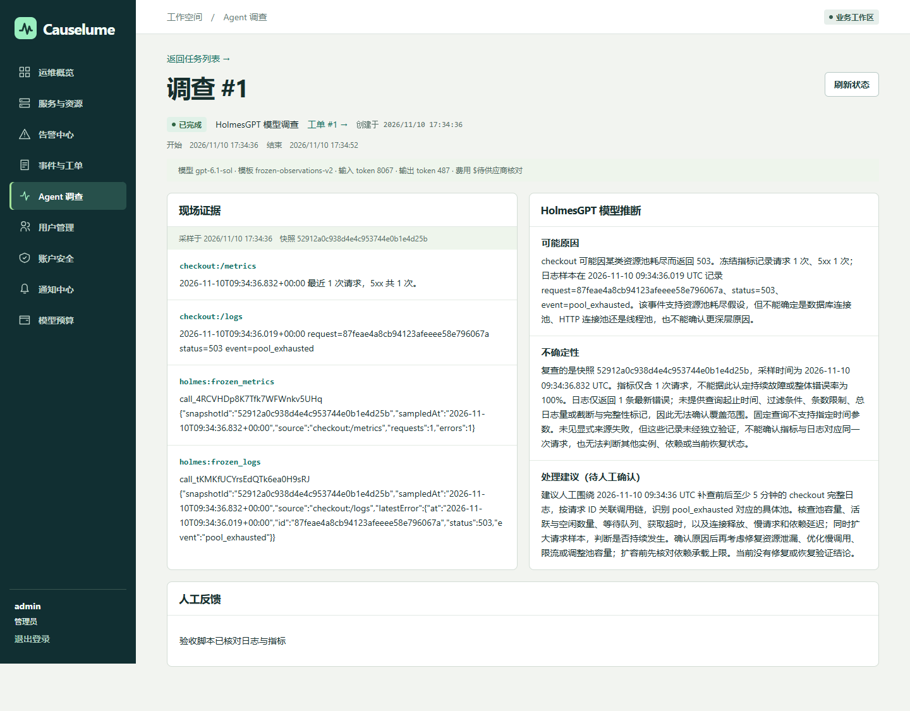
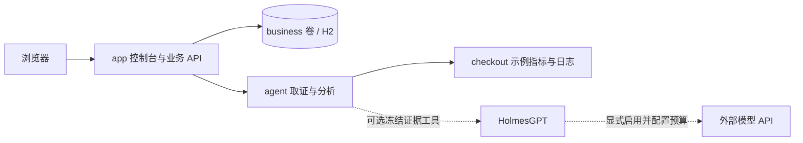
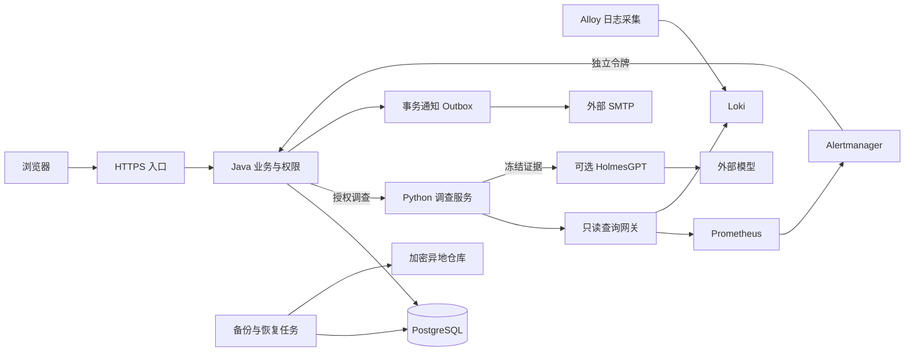

# Causelume · 故障诊断与协作平台

Causelume 面向个人开发者和小团队，将告警、工单、AI 故障调查与复盘串成一条处理流程。值班人员可以结合指标和日志定位问题，协作处理故障，并保留可追溯的证据与恢复记录。

[快速开始](#快速开始) · [第一次体验](#第一次体验) · [源码阅读入口](#源码阅读入口) · [文档导航](docs/README.md) · [Linux 部署](docs/production-setup.md)

当前版本：[v1.0.3](https://github.com/W205614/Causelume/releases/tag/v1.0.3)。应用通过公开 Docker/OCI 镜像分发，源码和第三方对应源码随 Release 提供。

- **体验界面**　打开部署后的 `/?demo=1`。页面标记「模拟数据」，可以试派工和调查；刷新会重置样例。
- **验证完整流程**　使用默认的离线模式。示例 checkout 会真正返回 503、生成日志与指标，Python 使用规则分析，全程无需模型密钥。
- **接入模型**　HolmesGPT 的两个只读工具复查该次调查冻结的证据。模型给出推断和不确定性，由负责人核对。真实调用会产生供应商费用。

## 控制台实景

以下截图来自演示模式（`/?demo=1`），使用内置样例数据。

查看工单时间线、调查证据和手机布局

[查看 390 像素宽的调查详情](docs/images/investigation-mobile.png)

以下为 **v1.0.3 实际模型调查**，于 2026-11-10 在隔离环境使用合成 checkout 故障采集。左侧是冻结指标、日志及两项真实工具返回，右侧是模型推断和不确定性；分析建议需要人工核对。

本次调查成功并完成 503→200 恢复闭环；画面保留调查时点的分析，不将后续恢复写成模型已经确认的结果。费用待供应商核对，单次验收不能证明长期可用性。素材来源与边界见 [发布验证](docs/release-1.0.3.md)。

## 适用范围与主要能力

项目采用单实例、单 worker，提供共享运维工作区。管理员维护账户、服务与派工；成员共享查看工单和诊断证据，负责人及管理员推进处理、记录复盘并导出报告。支持 Docker Desktop 本地运行和 Linux 单机部署。

| 能力 | 已实现内容 |
|---|---|
| 账户与权限 | 会话、角色、密码管理、停用与会话撤销；生产 profile 强制 TOTP 和单次恢复码 |
| 告警与通知 | Alertmanager 发生/恢复、去重、服务和环境映射、维护静默、站内消息及邮件投递状态 |
| 服务与工单 | 服务维护、负责人、筛选分页、优先级、时间线、重开、恢复依据、结构化复盘及改进项 |
| 调查与证据 | 受限 Prometheus/Loki 查询、冻结快照、来源和完整性、模型推断与人工反馈分区 |
| 费用控制 | 人工发起模型调查、每日预算预留、未知费用保留额度及人工核对 |
| 数据与交付 | H2→PostgreSQL 核对迁移、生产编排、加密备份、隔离恢复、平台指标、CI 扫描及摘要发布 |

## 快速开始

| 使用方式 | 需要的本机工具 | 入口 |
|---|---|---|
| 直接使用已发布镜像 | Git、Python 3.13、Docker/Compose | 下方快速开始 |
| 修改源码后在 Docker 中构建 | 同上；构建工具在镜像内 | [源码 Docker 构建](#源码开发与测试) |
| 在宿主机开发和测试 | Java 21、Maven、Node.js 22、Python 3.13；集成测试还需 Docker | [源码开发与测试](#源码开发与测试) |

### 准备环境

本地体验需要 Git、Python 3.13 和已启动的 [Docker Desktop](https://docs.docker.com/compose/install/)（使用 Linux 容器）。Linux 也可使用 Docker Engine 与 Compose 插件。默认直接运行已发布的 app 和 agent 镜像，本机无需安装 Java、Maven 或 Node.js，也无需编译源码。

在终端检查：

~~~sh
git --version
python --version
docker version
docker compose version
~~~

首次启动需要联网从 GHCR 拉取公开镜像，无需登录 GitHub。默认采用离线调查模式，无需模型密钥、域名或 SMTP。

当前发布镜像的平台为 `linux/amd64`，适用于 x86-64 主机上的 Linux 容器环境。

### 克隆并启动

~~~sh
git clone --branch v1.0.3 --depth 1 https://github.com/W205614/Causelume.git
cd Causelume
python scripts/init_env.py
docker compose pull app agent checkout
docker compose up -d --no-build --wait --wait-timeout 180 app agent checkout
~~~

执行 `docker compose ps`，确认 `app`、`agent`、`checkout` 三个服务均为 `healthy`。打开 [健康检查](http://127.0.0.1:18760/api/health)，应看到 `{"status":"UP"}`。

以上克隆固定版本 `v1.0.3`，其源码提交为 `6dc18d68dfdaf62406e430a8296923fd5e25283f`。根目录 `compose.yaml` 已将服务名映射到下面的完整镜像地址，`docker compose pull app agent checkout` 会读取这些地址；`app`、`agent` 是服务名。`checkout` 以不同命令复用 agent 镜像，无需第三个 Package。

| Compose 服务 | 默认公开镜像 | 本版不可变摘要 |
|---|---|---|
| `app` | `ghcr.io/w205614/causelume-app:v1.0.3` | `sha256:014563da9123dd0f1c4b83273cfb3ce99c3f707dbef5f5be8130152cf50d05af` |
| `agent`、`checkout` | `ghcr.io/w205614/causelume-agent:v1.0.3` | `sha256:bb2a8d926fea0a336bae11190161bf6fc17622b8c3564a4ce2cd89a2cc6d3244` |

两个镜像也提供完整源码提交号标签，内容与版本标签一致。[app Package](https://github.com/users/W205614/packages/container/package/causelume-app) · [agent Package](https://github.com/users/W205614/packages/container/package/causelume-agent) · [Release 镜像清单](https://github.com/W205614/Causelume/releases/download/v1.0.3/images.json)。本版安全修复、扫描和真实运行边界见 [v1.0.3 发布验证](docs/release-1.0.3.md)。

### 登录和体验

用文本编辑器打开项目根目录的 `.env`，查找对应的初始密码：

| 入口 | 账号 | 密码 |
|---|---|---|
| [业务控制台](http://127.0.0.1:18760) | `admin` / `operator` | `.env` 中的 `APP_ADMIN_PASSWORD` / `APP_OPERATOR_PASSWORD` |
| [界面演示](http://127.0.0.1:18760/?demo=1) | `admin` / `operator` | `demo` |

业务控制台读写数据库；界面演示使用浏览器内的样例数据。先用 `admin` 登录业务控制台，可在概览查看服务和工单，在「服务与资源」查看内置的 checkout 服务。

停止服务使用 `docker compose stop`；下次使用 `docker compose up -d --no-build --wait --wait-timeout 180 app agent checkout`。业务数据保存在 Docker 命名卷中，停止后保留。

已有部署与本机配置

已有 `.env` 时跳过初始化，沿用现有账户和数据。升级前备份数据库并在副本上验证迁移，更新镜像后重新创建容器。操作步骤见 [数据迁移](backend/STORAGE.md) 和 [运维手册](docs/operations.md)。

`.env` 中的 `APP_IMAGE` 和 `AGENT_IMAGE` 未设置或留空时使用上表的版本标签。需要按摘要锁定时，将两者设为完整引用 `ghcr.io/w205614/causelume-app@sha256:…` 和 `ghcr.io/w205614/causelume-agent@sha256:…`，填入上表或目标 Release 的实际摘要，再执行拉取和启动命令。升级不覆盖旧公开版本；更新配置也不会重置已有数据库中的账号密码。

本机配置可放在不入库的 `compose.override.yaml`。Compose 默认自动合并它；使用 `-f` 时同时列出所需的覆盖文件。`AGENT_MODE=offline` 使用离线规则，`holmes` 使用真实模型。

## 第一次体验

默认离线模式下，可以先用一个正常请求体验管理员和运维人员的协作：

1. 在浏览器打开 [checkout 示例请求](http://127.0.0.1:18761/checkout)，确认返回200，生成一条可供调查的请求样本。
2. 用 `admin` 登录业务控制台，点击「创建工单」，选择 checkout，填写「核对 checkout 服务状态」。进入工单详情，点击「分派」，选择 `operator` 并填写处理说明。
3. 退出管理员，用 `operator` 和 `.env` 中对应的密码登录。打开刚才的工单，依次点击「开始处理」「发起调查」，查看采样指标、离线分析与处理建议。
4. 再次请求 checkout 确认200，在工单中点击「验证恢复」，选择「通过，已有恢复依据」并记录结果。随后点击「关闭并复盘」，填写影响范围、起止时间、原因、不确定性和复盘记录，查看保存后的处理时间线。

接下来可用下面的脚本体验一次实际503故障及恢复。

## 完成一条故障流程

本地首次体验时，在项目根目录执行：

~~~sh
python scripts/e2e.py --env-file .env --expect-mode offline
~~~

脚本会在当前本地实例创建一条验收工单，自动完成：

1. 让 checkout 实际返回 503，记录日志与指标。
2. 录入告警、创建工单，分派给 operator 并开始处理。
3. 发起离线调查，保存证据、分析和人工反馈。
4. 解除故障并实测 HTTP 200，记录恢复依据，填写复盘并关闭工单。

终端出现 `Passed: ... offline investigation; HTTP 503 -> 200` 即表示流程通过。回到控制台，在「事件与工单」查看生成的工单与时间线，在「Agent 调查」查看该次结果和证据。

## 部署与外部服务接入

本地体验之后，可按需部署到 Linux 单机，使用 PostgreSQL 18、TOTP、邮件通知、Prometheus/Alertmanager/Loki/Alloy、Caddy HTTPS 和加密备份。准备主机、域名及服务账户后，按下表填写配置。凭据存放在受限文件中。

完整步骤见 [Linux 接入手册](docs/production-setup.md)。v1.0.3 的镜像已发布，可直接使用 Release 中的摘要；普通使用者无需触发发布工作流。源码版本与对应源码材料见 [GitHub Releases](https://github.com/W205614/Causelume/releases)。

查看外部服务配置与发布命令

| 资源 | 填写位置 | 接入与验收 |
|---|---|---|
| Linux 云主机 | 部署目录 /opt/causelume，Docker Engine/Compose，防火墙 | 拉取已验证提交、下载发布镜像，检查磁盘与资源；备份旧部署后运行发布脚本。只对外发布 80/443。 |
| 域名与 TLS | production.env 的 APP_DOMAIN、ACME_EMAIL | 将 DNS 指向主机，放通 80/443，Caddy 自动申请并续期证书；访问真实域名验证 Cookie、MFA、证书与重定向。 |
| SMTP | production.env 的 SMTP_HOST/PORT/USERNAME/FROM，secrets/SMTP_PASSWORD | 使用服务商授权凭据。登录账户安全页设置收件邮箱；发出测试通知，核对实际收件和投递状态。 |
| 异地备份 | production.env 的 RESTIC_REPOSITORY，secrets/RESTIC_PASSWORD、AWS_ACCESS_KEY_ID、AWS_SECRET_ACCESS_KEY | 初始化专用 restic 仓库，执行首次备份、隔离恢复；再启用每12小时备份与每月恢复演练定时器。 |
| 外部探测 | heartbeat.env、production.env 的 BACKUP_HEARTBEAT_URL | 使用机外心跳服务检查平台运行和备份，配置周期与宽限，并验证心跳停止后的告警。 |
| 真实模型 | secrets/OPENAI_API_KEY、AGENT_MODE=holmes、COMPOSE_PROFILES=holmes、预算变量 | 使用专用密钥，填写每日额度和单次预留。调查由人发起，按供应商计费；未知费用保留额度待核对。 |
| 实际应用 | 服务目录和 deployment/observability 配置 | 注册 Prom 抓取目标和 Alloy 日志标签；在页面绑定批准的 prom-loki 数据源、serviceLabel 与 environment，检测连接后演练一次真实故障。 |

首次准备服务器配置：

~~~sh
cp production.env.example production.env
python scripts/init_production.py
~~~

编辑 production.env 和 secrets/ 外部凭据文件。保管 APP_MFA_KEY 与 restic 恢复密码的独立恢复副本。生产账户的首次绑定及恢复见 [账户与数据迁移](backend/STORAGE.md)。

创建 Tag 或 Release 不会自动部署服务。使用已发布版本时，从目标 Release 的 `images.json` 取得 app/agent 完整摘要引用，填入 `APP_IMAGE`、`AGENT_IMAGE`，`APP_RELEASE` 填镜像来源提交号。维护者发布新版本才需要手动镜像工作流。部署前检查目标版本的安全扫描、备份和外部资源，运行：

~~~sh
docker compose --env-file production.env -f compose.production.yaml -f compose.observability.yaml config --quiet
sudo sh scripts/release.sh
~~~

发布脚本默认在 /opt/causelume 运行。已有实例更新时先执行加密备份，再迁移和检查健康。首次部署需要先初始化 restic 仓库，后续启用备份定时器。外部资源的详细接入、恢复及回退操作见 [生产接入手册](docs/production-setup.md)。

## 日常故障处理

1. Alertmanager 的发生事件按集成、fingerprint、startsAt 去重，自动创建并分派工单。恢复事件记录监控恢复，由负责人确认工单关闭。
2. 通知中心显示站内消息和邮件状态；管理员可检查失败及结果未知的投递。维护静默会继续记录告警。
3. 工单负责人发起只读调查，核对证据、可能原因和建议，再执行处理操作。调查详情保留查询范围、来源、采集时间和完整性。
4. 写入通过、失败或未知的恢复依据；完成结构化复盘、改进事项、授权导出。必要时可重新打开工单。

服务支持编辑、停用、环境、负责人、运行手册和批准数据源绑定。账户支持密码管理、TOTP、单次恢复码和会话撤销。费用核对、清理预览、MFA 和账户管理只向相应权限开放。历史数据清理仅提供预览。

## 系统架构

Java 21/Spring Boot/Spring JDBC 负责业务、权限、持久化与任务；Python 与 HolmesGPT 负责采集和分析。Linux 部署采用 PostgreSQL，由独立迁移任务升级数据库，业务进程使用单独的运行账户。查询网关提供 Prometheus/Loki 的只读入口，观测组件通过内部网络连接。通知通过事务 Outbox 投递，调查 worker 在 Java 进程内运行。

默认本地路线中，app 同时提供控制台与 API，使用 H2 命名卷；agent 采集 checkout 的指标和日志并执行离线规则分析。只有显式启用 Holmes 模式时才连接外部模型：

查看 Linux 部署架构图

每次调查冻结服务范围和时间窗口，并展示来源缺失、样本截断及模型执行状态。平台预算控制调查准入，实际费用以供应商账单核对。备份策略、恢复目标和扩容条件见 [运维手册](docs/operations.md)。

## 源码阅读入口

~~~text
frontend/    原生 ES 模块控制台、样例数据与浏览器测试
backend/     Java 业务 API、权限、任务、数据库迁移与测试
agent/       Python 取证、冻结快照、Holmes 接口与 checkout 示例
deployment/  观测、HTTPS、数据库、备份和定时任务配置
scripts/     配置初始化、流程验收、迁移验证与发布脚本
docs/        接入手册、接口说明、业务规则与验证记录
.github/     CI 检查与镜像发布工作流
~~~

追踪刚才的工单操作，可从 [控制台交互](frontend/public/app.js) 进入 [API 请求封装](frontend/public/api.js)，再看 [工单接口与事务](backend/src/main/java/io/causelume/Tickets.java)。调查链路依次经过 [任务创建](backend/src/main/java/io/causelume/Investigations.java)、[后台执行](backend/src/main/java/io/causelume/InvestigationWorker.java) 和 [采集与模型分析](agent/investigator.py)。

接口字段见 [API 契约](backend/API.md)，证据与模型工具见 [调查服务](agent/README.md)，其他操作按 [文档导航](docs/README.md) 查阅。

## 源码开发与测试

源码 Docker 构建沿用快速开始的 Git、Python 和 Docker/Compose；Java/Maven/Python 依赖在构建阶段安装。宿主机开发与下面的测试命令使用 Java 21、Maven、Node.js 22 和 Python 3.13。

修改源码后，使用显式构建覆盖文件启动开发镜像（先完成 `.env` 初始化）：

~~~sh
docker compose -f compose.yaml -f compose.build.yaml up -d --build --wait --wait-timeout 180 app agent checkout
~~~

这会从当前源码构建本地 `causelume-app`、`causelume-agent` 和 `causelume-checkout` 镜像；构建需联网下载 Maven/PyPI 依赖。后续开发操作沿用这两个 `-f` 参数，有本机覆盖文件时再显式追加 `-f compose.override.yaml`。省略构建覆盖文件会恢复使用发布镜像。

宿主机开发先建立独立 Python 环境（Windows PowerShell 激活 `.\.venv\Scripts\Activate.ps1`，Linux/macOS 使用 `source .venv/bin/activate`），再安装依赖：

~~~sh
python -m venv .venv
~~~

激活环境后执行：

~~~sh
python -m pip install -r agent/requirements.txt
npm --prefix frontend ci
cd frontend
npx playwright install chromium
npm test
cd ..
mvn -f backend/pom.xml verify
python -m unittest discover -s agent -p "test*.py"
python scripts/verify_local.py
python scripts/verify_postgres.py
python scripts/verify_backup.py
python agent/verify_observability.py
python agent/verify_alertmanager.py
python scripts/verify_candidate.py
~~~

可用 `CAUSELUME_BROWSER` 环境变量指定本机 Edge/Chromium。`java`、`node` 和 `mvn` 需在 PATH；只有 `verify_postgres.py` 支持 `--maven` 指定 Maven 路径，`verify_local.py` 不支持该参数。先执行上面的 Maven 构建，再运行依赖本地 JAR 的验收。自动化验收使用独立测试数据、Mailpit 和离线调查。

`verify_local.py` 启动临时数据库与独立测试进程，结束后关闭；它用于验收，不是持久化日常开发服务器。测试覆盖浏览器交互、业务 API、数据库迁移、告警通知、观测取证、模型工具协议及备份恢复。当前版本的离线、真实模型及日常升级结果见 [v1.0.3 发布验证](docs/release-1.0.3.md)。

## 常见问题

- **找不到 `python` 命令？** Windows 可使用 `py -3.13`，macOS/Linux 可使用已安装的 `python3`，替换文档中的 `python`。
- **已有 `.env`，初始化报 FileExistsError？** 跳过初始化，保留原配置；脚本不会覆盖已有凭据。
- **端口被占用？** 在 `.env` 修改 `APP_PORT` 或 `CHECKOUT_PORT` 后重新运行启动命令。相应调整访问地址；验收脚本可用 `--app`、`--checkout` 指定新地址。
- **服务未进入 healthy？** 用 `docker compose logs --tail 100 app agent checkout` 查看启动日志，再按报错检查配置或 GHCR 镜像的下载连接。
- **本地运行需要云主机、域名或 SMTP 吗？** 不需要，按快速开始使用 Docker Desktop 即可。配置 SMTP 后可将站内通知同时投递到邮箱。
- **如何切换模型模式？** 默认使用 `AGENT_MODE=offline`。设置模型密钥、预算、`AGENT_MODE=holmes` 和 `COMPOSE_PROFILES=holmes` 后，重新创建容器；本机覆盖文件中的模式设置也需同步调整。
- **如何反馈问题？** 提供提交号或镜像摘要、复现步骤和脱敏日志。配置排查见 [安全说明](backend/SECURITY.md) 和 [运维手册](docs/operations.md)。

更多配置、接口和操作说明见 [文档导航](docs/README.md)。参与开发见 [贡献指南](CONTRIBUTING.md)，安全问题通过 [私密报告流程](SECURITY.md) 反馈。

## 许可证

本项目自有代码和素材采用 [MIT 许可证](LICENSE)，Copyright (c) 2026 W205614。第三方依赖和独立运行的外部组件保留各自许可证，详见 [第三方说明](THIRD_PARTY_NOTICES.md)。
